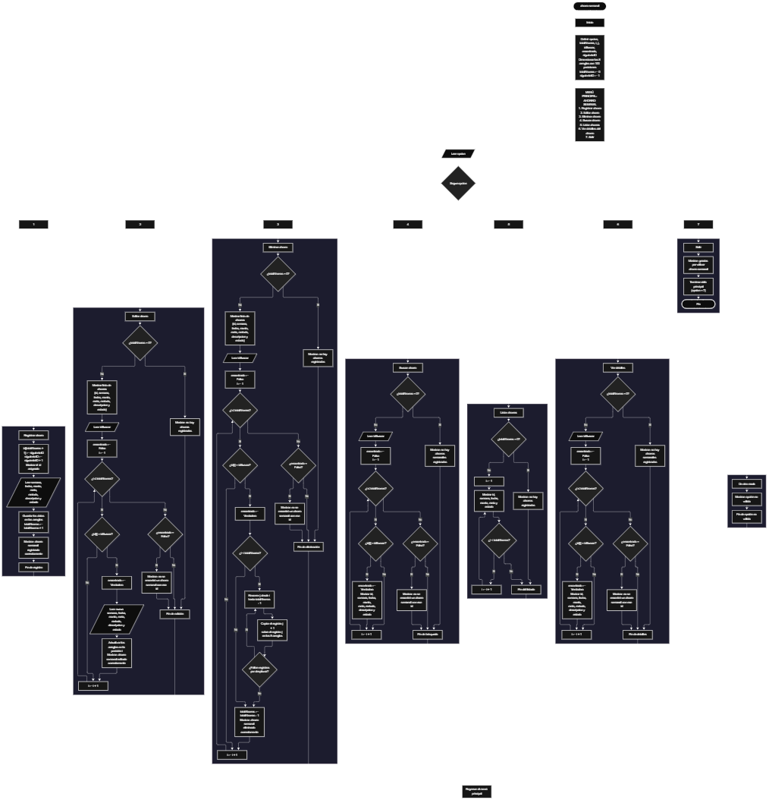

Este proyecto, llamado <b>ahorro semanal</b>, fue desarrollado en <b>pseint</b> como un ejercicio práctico para fortalecer la lógica de programación mediante la creación de un sistema de gestión de ahorros semanales desde la consola. El programa cuenta con un menú principal de siete opciones que permite <b>registrar, editar, eliminar, buscar, listar y consultar los detalles</b> de los ahorros registrados. Cada ahorro almacena datos como el identificador, la semana, la fecha, el monto, la meta, el método, la descripción y el estado, utilizando arreglos con una capacidad de <b>100 posiciones durante la ejecución</b>. Durante su desarrollo se aplicaron conceptos fundamentales de programación, como variables, arreglos, estructuras condicionales, ciclos repetitivos y estructuras de selección, además de procesos para buscar, modificar, eliminar y reorganizar registros. Este proyecto permite poner en práctica los conocimientos adquiridos en PSeInt y sirve como base para desarrollar sistemas de gestión más avanzados utilizando otros lenguajes y tecnologías.

<h2 align="center">⚙️ Funcionamiento del menú principal</h2>

### ➕ Registrar ahorro

La opción <b>1) registrar ahorro</b> permite añadir un nuevo ahorro semanal. El programa asigna automáticamente un <b>id</b> mediante la variable <b>siguienteID</b>, que aumenta en uno con cada registro, y lo muestra en pantalla. Después, solicita la <b>semana, la fecha, el monto, la meta, el método, la descripción y el estado</b>, y guarda cada dato en la posición correspondiente de sus arreglos (<b>totalAhorros + 1</b>). Finalmente, la variable <b>totalAhorros</b> aumenta en uno y se muestra el mensaje <b>"ahorro semanal registrado correctamente."</b>.

### ✏️ Editar ahorro

La opción <b>2) editar ahorro</b> permite modificar la información de un ahorro registrado. Primero, el programa comprueba si <b>totalAhorros</b> es igual a cero; si no hay registros, muestra el mensaje <b>"no hay ahorros registrados."</b>. En caso contrario, presenta una lista con el id, semana, fecha, monto, meta, método, descripción y estado de cada ahorro, y solicita el <b>id</b> del ahorro que se desea editar. Después, inicializa la variable lógica <b>encontrado</b> con el valor <b>falso</b> y utiliza un ciclo <b>para</b> que recorre el arreglo <b>id</b>. Cuando encuentra una coincidencia, cambia <b>encontrado</b> a <b>verdadero</b>, solicita la nueva <b>semana, fecha, monto, meta, método, descripción y estado</b>, actualiza directamente los valores de los arreglos y muestra el mensaje <b>"ahorro semanal editado correctamente."</b>. Si no existe un ahorro con ese id, presenta el mensaje <b>"no se encontró un ahorro semanal con ese id."</b>.

### 🗑️ Eliminar ahorro

La opción <b>3) eliminar ahorro</b> permite eliminar un ahorro registrado mediante su <b>id</b>. Antes de comenzar, el programa comprueba que existan ahorros; si no hay, muestra el mensaje <b>"no hay ahorros registrados."</b>. Si hay registros, presenta una lista con el id, semana, fecha, monto, meta, método, descripción y estado, y solicita el id del ahorro que se desea eliminar. Un ciclo <b>para</b> recorre el arreglo <b>id</b> en busca de la coincidencia. Cuando la encuentra, cambia <b>encontrado</b> a <b>verdadero</b> y, si el ahorro no es el último, utiliza un segundo ciclo <b>para</b> controlado por la variable <b>j</b>, que desplaza una posición hacia atrás los datos de los ahorros posteriores en los ocho arreglos. Posteriormente, disminuye la variable <b>totalAhorros</b> en uno y muestra el mensaje <b>"ahorro semanal eliminado correctamente."</b>. Si no existe un ahorro con ese id, presenta el mensaje <b>"no se encontró un ahorro semanal con ese id."</b>.

### 🔎 Buscar ahorro

La opción <b>4) buscar ahorro</b> permite localizar un ahorro mediante su <b>id</b>. Primero, el programa comprueba si existen ahorros registrados. Si no hay, muestra el mensaje <b>"no hay ahorros semanales registrados."</b>. En caso contrario, inicializa la variable lógica <b>encontrado</b> con el valor <b>falso</b> y solicita el id. Un ciclo <b>para</b> recorre el arreglo <b>id</b> y compara cada valor con <b>idBuscar</b>. Cuando encuentra una coincidencia, cambia <b>encontrado</b> a <b>verdadero</b> y muestra en una sola línea el id, semana, fecha, monto, meta, método, descripción y estado. Si termina el recorrido sin coincidencias, presenta el mensaje <b>"no se encontró un ahorro semanal con ese id."</b>.

### 📋 Listar ahorros

La opción <b>5) listar ahorros</b> permite visualizar todos los ahorros registrados. Si <b>totalAhorros</b> es igual a cero, muestra el mensaje <b>"no hay ahorros registrados."</b>. En caso contrario, utiliza un ciclo <b>para</b> que recorre los arreglos desde la primera posición hasta el total de ahorros y muestra, en una línea por registro, el <b>id, semana, fecha, monto, meta y estado</b>. Esta función facilita consultar los registros existentes sin necesidad de buscar cada ahorro individualmente.

### 📄 Ver detalles del ahorro

La opción <b>6) ver detalles del ahorro</b> permite consultar todos los datos de un ahorro específico. Primero, comprueba si existen ahorros registrados; si no hay, muestra el mensaje <b>"no hay ahorros semanales registrados."</b>. Después, solicita el <b>id</b> y recorre el arreglo <b>id</b> en busca de una coincidencia. Si la encuentra, muestra cada dato en su propia línea: <b>id, semana, fecha, monto, meta, método, descripción y estado</b>. Si no existe un ahorro con ese id, presenta el mensaje <b>"no se encontró un ahorro semanal con ese id."</b>.

### 🚪 Salir del menú principal

La opción <b>7) salir</b> finaliza la ejecución del programa y muestra el mensaje <b>"gracias por utilizar ahorro semanal."</b>. El menú principal se encuentra dentro de una estructura repetitiva <b>repetir ... hasta que</b>, cuya condición de salida es <b>opcion = 7</b>, por lo que el menú se mantiene activo hasta que el usuario selecciona la opción de salida.

<h2 align="center">🧠 Temas aplicados en el proyecto</h2>

### 📦 Variables

En este proyecto se utilizan variables para guardar la opción seleccionada en el menú, controlar la cantidad de ahorros registrados, generar los identificadores, recorrer los arreglos, almacenar el id que se desea buscar y comprobar si se encontró una coincidencia. Cada variable cumple una función específica dentro de las operaciones de gestión de ahorros.

🔢 **Opcion:** Almacena la opción seleccionada por el usuario en el menú principal.

📊 **TotalAhorros:** Almacena la cantidad actual de ahorros registrados.

🆔 **SiguienteID:** Almacena el próximo identificador que se asignará a un nuevo ahorro.

🔄 **I:** Funciona como contador en los ciclos <b>para</b> que recorren los arreglos.

🔁 **J:** Controla el recorrido utilizado para desplazar los datos durante la eliminación de un ahorro.

🔎 **IdBuscar:** Almacena el id introducido por el usuario para buscar, editar, eliminar o consultar un ahorro.

✅ **Encontrado:** Variable lógica que indica si se encontró un ahorro con el id solicitado.

### 🗃️ Arreglos

En este proyecto se utilizan ocho arreglos relacionados con los datos de cada ahorro. Cada arreglo tiene una capacidad de <b>100 posiciones</b> y utiliza el mismo índice para representar la información correspondiente a un mismo ahorro. Por ejemplo, los datos de un ahorro almacenado en la posición <b>1</b> se encuentran distribuidos entre <b>id[1], semana[1], fecha[1], monto[1], meta[1], metodo[1], descripcion[1] y estado[1]</b>. Esta organización permite recorrer, buscar, modificar, mostrar y eliminar los ahorros de manera ordenada.

🆔 **Id[100]:** Almacena el identificador único de cada ahorro.

📅 **Semana[100]:** Almacena la semana del ahorro.

🗓️ **Fecha[100]:** Almacena la fecha del ahorro.

💰 **Monto[100]:** Almacena el valor ahorrado.

🎯 **Meta[100]:** Almacena la meta de ahorro.

💳 **Metodo[100]:** Almacena el método utilizado para ahorrar.

📝 **Descripcion[100]:** Almacena una descripción del ahorro.

📌 **Estado[100]:** Almacena el estado del ahorro.

### 🔀 Estructuras condicionales

En este proyecto se utilizan las estructuras <b>si</b> y <b>sino</b> para comprobar si existen ahorros registrados antes de editar, eliminar, buscar, listar o consultar detalles, para identificar el ahorro que coincide con el id introducido, para decidir si es necesario desplazar registros al eliminar y para determinar si se encontró el id buscado. Estas condiciones permiten que el programa responda de manera diferente según el estado de los registros y el resultado de cada operación.

### 🔄 Estructuras repetitivas

En este proyecto se utilizan los ciclos <b>para</b> y <b>repetir ... hasta que</b>. Los ciclos <b>para</b> permiten recorrer los arreglos para mostrar los ahorros, buscar ids y acceder a los registros seleccionados. Durante la eliminación, también se utilizan para desplazar los datos de los ahorros posteriores una posición hacia atrás. Por otro lado, el ciclo <b>repetir ... hasta que</b> mantiene activo el menú principal para que el usuario pueda ejecutar diferentes operaciones antes de salir del programa.

### 🎯 Estructura según

El programa evalúa el valor almacenado en la variable <b>opcion</b> y ejecuta el bloque de instrucciones correspondiente. Cada caso representa una operación específica del sistema: <b>registrar, editar, eliminar, buscar, listar, ver detalles o salir</b>. También se utiliza el bloque <b>de otro modo</b> para mostrar el mensaje <b>"opción no válida."</b> cuando el valor introducido no coincide con ninguna de las opciones definidas.

### 🔢 Dimensionamiento de arreglos

El programa utiliza la instrucción <b>dimension</b> para establecer la capacidad de los arreglos que almacenan la información de los ahorros. Se definieron <b>100 posiciones</b> para cada arreglo. La cantidad de posiciones ocupadas se controla mediante la variable <b>totalAhorros</b>, por lo que las operaciones recorren únicamente los registros comprendidos entre la primera posición y el total actual de ahorros.

### 🆔 Generación automática de identificadores

Cada vez que se registra un ahorro, el programa asigna el valor actual de <b>siguienteID</b> al arreglo <b>id</b> y luego lo aumenta en uno. De esta manera, cada ahorro tiene un identificador único que se utiliza para buscarlo, editarlo, eliminarlo y consultar sus detalles, incluso después de eliminar otros registros.

### 🔄 Reorganización de registros

Cuando se selecciona un ahorro para eliminarlo y este no es el último registro, el programa utiliza un ciclo <b>para</b> que comienza en la posición del ahorro y llega hasta <b>totalAhorros - 1</b>. En cada repetición, los datos de la posición siguiente se copian sobre la posición actual en los ocho arreglos: <b>id, semana, fecha, monto, meta, metodo, descripcion y estado</b>. Después, la variable <b>totalAhorros</b> disminuye en uno. De esta manera, los ahorros posteriores ocupan las posiciones disponibles sin dejar espacios vacíos entre los registros activos.

<h2 align="center">¿Cómo se implementaron las operaciones crud en el proyecto?</h2>

Las operaciones <b>crud</b> se implementaron mediante las opciones del menú principal, permitiendo administrar los ahorros registrados. La operación <b>crear</b> corresponde a <b>registrar ahorro</b>, donde se introducen los datos de un nuevo ahorro; <b>leer</b> se realiza mediante las opciones <b>buscar ahorro, listar ahorros y ver detalles del ahorro</b>; <b>actualizar</b> corresponde a <b>editar ahorro</b>, donde se modifican los datos de un ahorro registrado; y <b>eliminar</b> se realiza mediante la opción <b>eliminar ahorro</b>. Estas operaciones utilizan variables, arreglos, condicionales y ciclos para gestionar la información almacenada temporalmente durante la ejecución del programa.

<h2 align="center">Diagrama de flujo del proyecto</h2>

<h2 align="center">🛡️ Validaciones del programa</h2>

### 📭 No existen ahorros registrados

Esta validación se utiliza en las opciones de <b>editar, eliminar, buscar, listar y ver detalles</b>. El programa comprueba si la variable <b>totalAhorros</b> es igual a <b>0</b> y, si no existen ahorros registrados, muestra el mensaje <b>"no hay ahorros registrados."</b> (o <b>"no hay ahorros semanales registrados."</b> en buscar y ver detalles). Esta comprobación evita continuar con operaciones que necesitan información almacenada cuando no hay registros.

### ❌ Ahorro no encontrado

Esta validación se utiliza en las opciones de <b>editar, eliminar, buscar y ver detalles</b>. El programa inicializa la variable lógica <b>encontrado</b> con el valor <b>falso</b> y recorre el arreglo <b>id</b> para comparar cada valor con el id introducido. Cuando encuentra una coincidencia, cambia la variable a <b>verdadero</b> y realiza la operación correspondiente. Si al finalizar el recorrido <b>encontrado</b> continúa siendo <b>falso</b>, muestra el mensaje <b>"no se encontró un ahorro semanal con ese id."</b>.

### ⚠️ Opción no válida

La estructura <b>segun</b> incluye el bloque <b>de otro modo</b>, que muestra el mensaje <b>"opción no válida."</b> cuando el usuario introduce un número que no corresponde a ninguna de las opciones definidas en el menú.

<h2 align="center">🚧 Mejoras pendientes</h2>

Como parte de la evolución del proyecto, se identificaron las siguientes mejoras para versiones futuras:

- ⚠️ Validar que <b>totalAhorros</b> no supere la capacidad de <b>100</b> posiciones antes de registrar un nuevo ahorro.
- 💰 Definir el tipo de dato de cada arreglo (por ejemplo, <b>monto</b> y <b>meta</b> como números reales) para poder realizar cálculos.
- 🧹 Limpiar la última posición ocupada después de eliminar un ahorro.
- 📅 Validar que la semana sea un valor válido y que el monto no sea negativo.
- 📊 Agregar el total ahorrado y el avance frente a la meta.

<h2 align="center">🎯 Objetivo del proyecto</h2>

El objetivo principal de este proyecto es fortalecer la <b>lógica de programación</b> mediante el desarrollo de un sistema de gestión de ahorros semanales en <b>pseint</b>. A través de su construcción se busca aplicar los conocimientos adquiridos sobre variables, arreglos, estructuras condicionales, ciclos repetitivos y estructuras de selección, integrándolos para resolver un problema de manera organizada. Además, el proyecto permite comprender cómo registrar, consultar, modificar y eliminar información en una aplicación de consola, estableciendo una base para desarrollar sistemas de gestión más completos con otros lenguajes y tecnologías.

